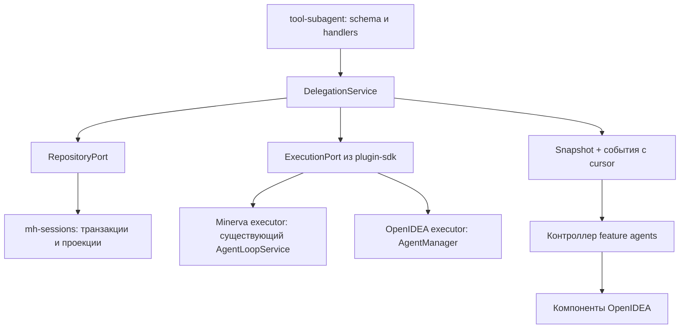

# План реализации делегирования Minerva

Дата: 26 ноября 2026 года. Статус: реализовано внутреннее делегирование,
запуск native Codex и Claude Code и отображение дочерних задач.
Включение по умолчанию закрыто. Дочерний ход наследует допущенные родителю
регистрации встроенных инструментов чтения и поиска. При отзыве регистрации
она исключается, даже если имя инструмента зарегистрировано снова. Итоги сохраняются в журнале
событий. Планировщик может автоматически продолжить свободный родительский
диалог на текущей ветке. В OpenIDEA дочерние задачи отображаются через
существующий интерфейс агентов.
Текст внутреннего субагента обновляется из событий сохранения сообщения.
Повтор события с тем же ID обновляет запись в дочернем чате.
Для native Codex подключена маршрутизация по проекту и сохранение задания до
запуска. Допуск к исполнению зависит от привязки к конкретному ходу Codex и
проверки режима ReadOnly, включая ограничения внешних инструментов.
На установленном Codex 0.172.0 проверен сценарий от инструментов Minerva через
очередь и проектный HostExecutor до двух ходов в одном диалоге. Дочерняя конфигурация отключает
apps и plugins и проверяет итоговый MCP-инвентарь перед каждым ходом.
Для native Codex проверены явные параметры model и effort. Каталог выбирается
для текущего проекта, effort проверяется для указанной модели. На Codex 0.172.0
живой тест с gpt-6.2-sol и low подтвердил выбор при замене недоступного
исполнителя и продолжение в исходном диалоге. Установки подтверждаются
адаптером до отправки запроса.
Тот же сценарий повторён с пустым кэшем каталога и без предварительного
открытия списка моделей. Обнаружение идёт через общий кэш OpenIDEA и ждёт
результата первичного обновления до восьми секунд.
Для Claude Code проверен запуск через HostExecutor с safe mode, пустой
MCP-конфигурацией и набором Read, Glob, Grep. Установленный CLI с локальным
модельным сервером прочитал контрольный файл внутри рабочей папки и отказал
в чтении снаружи. Проверка с реальной подпиской ожидает обновления авторизации.
Реестр допуска сохраняет UUID до запроса и отклоняет финальный результат с другим UUID.
На Windows проверены новые задачи с ограниченной записью. Claude Code использует
проверяемые Write/Edit, а Codex вызывает файловые инструменты OpenIDEA, допущенные
для конкретного запуска. В живых тестах Codex проверены запись, подтверждение
разовой записи и отказ в родительском чате. После записи Codex продолжил
исходный диалог с новым ходом в режиме чтения и прочитал созданный файл.
Тест с установленным Claude Code и локальной моделью подтвердил продолжение
с записью в том же диалоге. Следующий запрос к модели содержал предыдущую
историю, а запись за пределами рабочей папки была отклонена.
Продолжение с правом записи получает новый допуск по явному `writable: true`
в `subagent_send` и сохраняет исходный диалог. Для Codex требуется диалог,
который был создан с файловыми инструментами OpenIDEA. Живой тест адаптера
прошёл последовательность запись → чтение → запись в одном диалоге.
В Tauri два вызова `subagent_start` и `subagent_send` из одного родительского
хода получили отдельные подтверждения и записали два контрольных файла.
Журнал подтвердил один исходный диалог Codex, два разных хода и два
успешных результата. Очередь обычных уточнений работает в режиме чтения.
OpenIDEA сохраняет ID делегированного хода Codex из ответа `turn/start`, прежде
чем принимать события хода или открывать доступ к файловым инструментам.
Живой тест завершает процесс менеджера до решения по записи. После перезапуска
журнал сохраняет ID сессии и хода, запрещает повторный запуск и освобождает
рабочую папку после остановки дочернего процесса. Сквозная проверка в Tauri
также подтвердила остановку процесса Codex при аварийном выходе IDE во время
запроса на запись. После запуска OpenIDEA сохранила родительский чат и историю
отменённого субагента, сняла запрос на разрешение и не повторила ход или запись.
Этот сценарий выявил гонку наблюдения до сохранения квитанции запуска. Пока
попытка ждёт квитанцию, наблюдение оставляет её под управлением диспетчера.
`subagent_send` продолжает диалог внутреннего субагента с новой попыткой.
Поручения, отправленные во время работы, сохраняются в очереди и запускаются
по порядку после успешного завершения текущей попытки. Серверная операция остановки дерева закрывает
приём задач и отправляет запросы отмены потомкам. Кнопка Stop tree доступна
в чате Minerva рядом с активными субагентами. Для внутреннего Minerva-ребёнка
кнопка Send now назначает уже поставленное уточнение конкретному активному
запуску. Браузерный тест подтверждает, что кнопка передаёт ID очереди и запуска,
а новый черновик остаётся в поле. Интеграционный тест провайдера с локальным
HTTP подтверждает одну вставку после результата инструмента, подтверждение
после ответа и сохранение в истории того же запуска. В запущенной IDE
проверен путь от Send now до живой модели Codex: после ответа на вопрос
дочерний чат показал кодовое слово из уточнения. SQLite подтвердил статус
delivered, совпадение ID активного и получившего сообщение запуска, отсутствие
новой попытки и ровно одну копию уточнения в истории Rig. Отдельная реплика
пользователя проверена в нативном чате. Первая проверка выявила нарушение
порядка при потоковом ответе. Для исправления реплика теперь публикуется
при подготовке следующего шага, а части ответа до и после неё получают разные
стабильные ID. Повторная проверка в нативной IDE подтвердила порядок:
задание родителя, одна реплика пользователя, один ответ субагента. После
повторного открытия дочернего чата порядок и количество реплик сохранились.
Отдельно в нативной IDE проверено два уточнения в сохранённой очереди.
Обе строки остались доступны после повторного открытия дочернего чата.
Выбранное уточнение обработано в исходном запуске, второе завершилось
отдельной попыткой после него. Оба ответа появились в дочернем диалоге.
Повторный нативный прогон подтвердил авторство второго уточнения. Оно
отображается один раз под подписью You перед ответом субагента. SQLite хранит
эту реплику как user с происхождением ide-user-followup.
Архивация и удаление Minerva-чата сначала закрывают приём работы для
его дерева и запрашивают остановку детей. Пока есть активный ребёнок или
исход его запуска неизвестен, операция сохраняет чат и рабочую папку.
Проверками покрыты исходная сессия, граница проекта, пустое дерево и
неподтверждённый исход. Через штатные команды в нативном окне проверены обе
операции на одноразовых тестовых чатах. Первый вызов запросил отмену и
сохранил чат. Повтор после подтверждённой остановки завершил операцию.
Удаление проверено без удаления рабочей папки.
Для доставки в текущий ход внутреннего субагента точка интеграции — подготовка
следующего запроса Rig. `SelectionHook` привязан к смене модели, которую
исполнитель делегирования отключает через `liveSelection: false`. Поэтому
доставка получает общий источник сообщений для фиксированного и переключаемого
маршрутов. Подготовка запроса забирает сообщения по конкретному ID запуска
после завершения предыдущего пакета инструментов и до расчёта бюджета. В Rig 0.46
изменения истории от нескольких hooks не складываются: поздний `RequestPatch`
перезаписывает историю. Поэтому подготовка выбранного маршрута должна учитывать
уточнения в том же преобразовании, которое подаёт историю на расчёт бюджета.
Хранилище владеет очередью и идемпотентностью. При отсутствии
следующего запроса сообщение остаётся для нового хода. При неопределённом
исходе отправки после сбоя сообщение сохраняет состояние доставки до сверки.
Повторное поручение успешно завершившему native Codex использует сохранённый
thread и отдельный ID попытки. Тест с установленным Codex проверяет ответ
на поручение из очереди, идентификатор диалога и повтор квитанции.
В нативной OpenIDEA с локальным тестовым
провайдером проверены открытие активного дочернего чата, промежуточный и
полный ответ, а также отмена активного ребёнка кнопкой Stop tree.
В нативной OpenIDEA с живым Codex проверены постановка второго поручения
в очередь, открытие ребёнка из шапки и появление обоих ответов в открытом
чате. История дочернего Codex хранится в AgentManager и читается через
родительскую связь. Отдельный дочерний чат исключён из общего списка и
корневого потока событий задач.
В нативной OpenIDEA проверена отправка из дочернего чата Minerva на живой
модели. Пока ребёнок ожидал ответ на вопрос, интерфейс подтвердил постановку
уточнения в очередь. После ответа из родительского чата поручение получило
одну попытку и завершилось. Исходный ответ и ответ на уточнение появились
в том же дочернем чате.
Область: внутренние Minerva-субагенты и оркестрация полноценных агентов OpenIDEA.
Основание и закреплённые первичные источники: [design](minerva-delegation-design.md).
Этот документ определяет этапы и приёмку; design определяет архитектурные границы.
Если при реализации обнаружено противоречие, исправляем оба документа до кода.

## 1. Результат и границы первого выпуска

Пользователь ведёт основной диалог с Minerva. Модель может выбрать разрешённого
исполнителя, поставить задание, продолжить свою работу, получить вопрос или итог.
Исполнитель — отдельная Minerva-сессия на заданной модели либо native-агент
OpenIDEA с собственным циклом. Это разные execution targets, а не model providers.
Codex по подписке внутри Rig остаётся модельным маршрутом Minerva; native Codex
через AgentManager остаётся самостоятельным агентом.

Первый выпуск включает:

- discover/start/list/get/wait/send/interrupt и адресные вопросы/ответы;
- fresh внутреннего ребёнка и его дальнейшие поручения;
- хотя бы один реально доступный внешний движок с проверенным ReadOnly;
- сохранение связей, результатов, входящих сообщений и восстановление;
- дерево в истории и выбор ребёнка в шапке, открытие диалога, отправку сообщения,
  отдельные Stop и Stop tree, видимые причины отказа/неизвестного состояния;
- разрешённый пользователем выбор модели/effort/движка и bounded fallback.

Адресный ответ внутреннему субагенту связывается с его текущей попыткой.
Хранилище связывает вопрос с корневой и родительской сессиями, ID субагента,
попыткой, дочерней сессией, запуском и вызовом инструмента. Брокер принимает
ответ только при совпадении дочерней сессии, запуска, вызова и ID вопроса.
Содержательный ответ использует отдельный путь от выдачи разрешений.
После перезапуска запись вопроса остаётся доступной для истории, а утраченное
ожидание не создаётся заново. Принятие ответа и подтверждение доставки имеют
разные состояния. Ожидание результата сообщает о вопросе, когда переводит
управление родителю.
Внутренний субагент получает встроенный `ask_user`, если родитель допустил
именно эту регистрацию. `subagent_wait` возвращает `coordination-required`
с ожидающим вопросом. Родитель может опросить `subagent_questions` и передать
ответ через `subagent_answer`. Квитанция `delivered` подтверждает передачу
ответа в живое ожидание инструмента. OpenIDEA показывает вопрос в родительском
чате и отправляет ответ в тот же канал доставки по сохранённому адресу.
В нативном окне проверен вопрос через живую API-модель: выбранный в форме
вариант появился в карточке ответа и был возвращён дочерним агентом.
Рантайм может один раз пробудить свободного родителя для каждого ожидающего
вопроса на текущей ветке. Ход привязан к ID вопроса и проверяет состояние
ребёнка, ветку, поколение остановки и свободный слот в одной транзакции.
В этом ходе модель сообщает о вопросе пользователю. Ответ отправляется через
форму, ход пробуждения выполняется с пустым набором инструментов.
В нативной OpenIDEA с живыми моделями подтверждён один завершённый ход
пробуждения на ожидающем вопросе. После ответа из формы SQLite сохранил
состояние доставки и тот же единственный ход пробуждения. Родитель отдельно
получил итог завершившегося субагента.

Работа с записью файлов — отдельный этап после ReadOnly-приёмки, до общего
включения функции для кодирования. Не обещаем writable orchestration до его сдачи.
Автоматический DAG, удалённые машины, group broadcast, worktree provisioning,
полный fork истории и перенос истории Claude/Codex в Rig в первый выпуск не входят.
Внешние MCP/skills/auth предоставляет OpenIDEA; старые MH packages и собственные
Minerva skills не возвращаются. Не обновляем зависимости или upstream попутно:
в этапе 0 сверяем, выполнен ли прежний план обновления, и фиксируем отдельный долг.

## 2. Архитектура и владельцы



| Слой / целевое место                                | Отвечает за                                                      | Не делает                           |
| --------------------------------------------------- | ---------------------------------------------------------------- | ----------------------------------- |
| `plugin-sdk/src/delegation/`                        | DTO, typed IDs, capabilities, errors, единственный ExecutionPort | SQL, Rig, IDE types, UI             |
| `crates/delegation/src/`                            | admission, lifecycle, inbox, delivery, recovery; RepositoryPort  | создание CLI, OAuth, render         |
| `plugins/tool-subagent/src/`                        | схемы и тонкие handlers, регистрация/снятие инструментов         | собственный цикл, хранилище         |
| `plugins/mh-sessions/src/delegation/`               | миграции, транзакции, CAS, query/recovery, durable events        | вызовы executor и модели            |
| `crates/runtime/src/delegation/`                    | wiring и внутренний executor, lifecycle регистрации              | бизнес-правила в bootstrap          |
| `crates/ide-agent/src/delegation/`                  | host execution adapter, capabilities, mapping project/task       | копия запуска native CLI            |
| `crates/ide-minerva/src/`                           | передача host port в embedded runtime                            | обратная зависимость vendor от IDE  |
| `crates/ide-agent/src/native/minerva/delegation.rs` | перевод проекции в AgentEntry/host events                        | второй coordinator                  |
| `src/features/agents/delegation/`                   | selectors/controller и UI дерева/шапки                           | создание заданий мимо IPC, политика |

Имена новых путей — целевые, не повод создавать пустые файлы. Для каждого слоя
создаём файлы по мере появления ответственности. SDK начинаем с `mod.rs`,
`types.rs`, `capabilities.rs`, `ports.rs`; сервис — `admission.rs`, `lifecycle.rs`,
`messaging.rs`, `delivery.rs`, `recovery.rs`, `limits.rs`, `repository.rs`.
Repository делим на schema/mutations/queries/delivery/recovery; UI — controller,
selectors и небольшие компоненты. Не вводим общий utils или shared для всего:
общими становятся только действительно используемые несколькими потребителями
типы и чистые правила. Все лимиты делегирования принадлежат одному Limits config
в домене; UI получает effective limits, не дублирует числовые константы.

Запрещён цикл `mh-agent-loop -> mh-plugin-manager -> tool-subagent -> agent-loop`.
Composition root получает существующий loop service, создаёт executor и service,
после этого регистрирует инструменты. Host port передаётся через ide-minerva;
ссылки на AgentManager/runtime слабые либо имеют явный dispose, без Arc-цикла.
Runtime без host port поддерживает внутренних детей; external discover возвращает
недоступность с причиной. Bootstrap failure снимает уже созданные регистрации.

## 3. Контракт данных

| Сущность       | Идентичность и правила                                                |
| -------------- | --------------------------------------------------------------------- |
| Delegation     | устойчивый ребёнок: parent/root, workspace, engine, execution address |
| WorkItem       | отдельное поручение: spec, revision, критерий проверки, provenance    |
| Activation     | одна попытка WorkItem, выбранный target и capability snapshot         |
| Operation      | идемпотентный запрос; key = caller + operation ID, payload hash       |
| Message        | ID, sender/recipient, activation, correlation, source, sequence       |
| Result         | ID, activation, bounded summary, ссылки на доказательства, outcome    |
| Inbox consumer | владелец и generation; старое поколение теряет право ack              |

IDE task ID обозначает внешний диалог и не заменяет WorkItem ID. Target — tagged
enum Minerva(route, effort) или IdeAgent(agentId, validated options). Caller,
root, cwd, policy и доступ к истории берём из trusted context, не из JSON модели.
Повтор operation с тем же payload возвращает ту же квитанцию; с иным payload —
conflict. Новое поручение idle ребёнку создаёт WorkItem и Activation; retry
создаёт Activation того же поручения. Одновременно у ребёнка одна activation.

Хранилище mh-sessions сохраняет снимок каждой завершённой попытки отдельно.
Доставка итогов и пробуждение читают этот снимок. Старый итог остаётся
доступным до подтверждения, даже если у ребёнка уже началась новая попытка.
Первый сценарий повторного поручения использует существующую
сессию завершившегося внутреннего ребёнка и новый run ID. Доступные инструменты
определяет пересечение ограничений ребёнка и текущих разрешений родителя.
Каждая операция должна хранить ссылку на свою попытку. При повторе старой
операции возвращаем её квитанцию, даже если ребёнок выполняет другое поручение.
Сообщение работающему ребёнку получает отдельную квитанцию очереди, если движок
поддерживает продолжение диалога в режиме чтения. Квитанция сохраняется
с ID поручения. Идентификатор попытки появляется при продвижении очереди после
подтверждённого успешного завершения текущего хода. Записи обрабатываются по
порядку приёма. Остановка ребёнка или дерева отменяет ожидающие поручения,
сохраняя их квитанции для повторных запросов. Хранилище одной транзакцией
сохраняет новую попытку и её связь с квитанцией. Для расчёта доступных
инструментов координатор передаёт актуальные регистрации чтения родителя.
Рантайм принимает прямое пользовательское поручение из корневого диалога
через доверенный вызов OpenIDEA. Обращение проверяет владельца дерева, сохраняет
отдельный ID пользовательской операции и использует ту же очередь.
Набор инструментов учитывает ограничения последнего хода родителя как для
немедленного продолжения, так и при продвижении очереди.
При повторе `send` сначала проверяется квитанция очереди, в том числе для
уже запущенного поручения. Для Codex хост получает идентификаторы завершившегося
хода и его диалога. Перед продвижением очереди координатор заново проверяет
доступность продолжения диалога в режиме чтения.
При восстановлении очереди внутреннюю попытку можно запустить с прежним ID,
если в SQLite есть квитанция продвижения и нет записи этого запуска. Внутренний
движок записывает запуск до обращения к модели. Если запись уже существует,
координатор наблюдает исходную попытку и сохраняет неопределённый исход там,
где подтверждение отсутствует.
Регистрации инструментов действуют в пределах одного процесса. При
восстановлении старые разрешения чтения снимаются до запуска очереди.
Интеграционные тесты переоткрывают рантайм на той же базе и считают
фактические запросы к локальному провайдеру для обоих состояний.

ExecutionPort предоставляет discover, prepare/start, observe, send, interrupt,
reconcile и release в пределах объявленных capabilities. Точные Rust signatures
фиксируются этапом 1; DTO не используют AgentTask или Rig message. Prepare —
проверка без запуска; start возвращает handle либо различает rejected и unknown.
Unknown после сетевого/host сбоя не превращается в rejected.

Capability хранит supported/unsupported/unknown с причиной и областью гарантии:
ReadOnly, write policy, steer, queued follow-up, reuse, resume, effort, вопросы,
вложенные дети, остановка и измерение бюджета. Discover не доказывает авторизацию
следующего запроса. Проверка повторяется перед фактическим запуском. Каталог
содержит только разрешённые кандидаты; секреты и содержимое credential store туда
не попадают. Выбор модели LLM предлагает, код валидирует и фиксирует причину.

Квитанция send различает queued, steered, new-work-item и actual continuation:
reuse/resume/fresh-with-summary. Fresh требует явного opt-in. `prompt(now=true)`
не считается подтверждением steer: текущий AgentManager может queue+cancel.
Если точная квитанция недоступна, расширяем host-контракт, а не угадываем по UI.

Ошибки типизированы: invalid, forbidden, unsupported, unavailable, busy,
budget-exhausted, conflict, cancelled, outcome-unknown, storage-failed. Внешняя
граница преобразует их в IdeResult; пользовательский текст идёт в text catalog.

## 4. Переходы, конкурентность и ограничения

| Объект     | Состояния / обязательное поведение                                                              |
| ---------- | ----------------------------------------------------------------------------------------------- |
| Activation | accepted → starting → running/needs-input → stopping → terminal; unknown требует reconciliation |
| Outcome    | succeeded / failed / cancelled, отдельно от состояния процесса                                  |
| Validation | not-run / passed / failed / unavailable; связана с версией результата                           |
| Liveness   | live / exited / unknown; результат не доказывает выход процесса                                 |
| Delivery   | pending → claimed(generation) → acknowledged; replay идемпотентен                               |

Не все transitions линейны: отказ до запуска сразу даёт failed; подтверждённый
успех может прийти до ответа start. Таблица разрешённых переходов и CAS — единые
чистые функции домена. Нельзя откатить terminal старым heartbeat или завершить
новую попытку старым result. Результат старой попытки сохраняется в аудите.

Start: проверить caller/target → в транзакции reserve + intent + связь + event →
после commit вызвать executor → записать handle/state. События публикуются из
durable projection после commit, до работы ребёнка связь уже доступна UI.
Сбой между start и записью handle разбирает reconciliation по creation intent.
Cancel до commit отменяет старт; после принятия child живёт независимо от tool-call.
Executor/LLM/IPC никогда не вызываются под DB или tree lock. Для конкретного
ребёнка операции сериализуются; блокировки не удерживаются во время wait.

Конфигурация первого среза: максимум 4 одновременных дочерних activation на root,
16 созданных детей на root, глубина 2, максимум 8 idle executors. Это стартовые
проектные значения, централизованы и подлежат измерению при runtime-приёмке.
OpenIDEA удерживает до восьми подтверждённо простаивающих native-соединений
на проект. При превышении лимита закрывается самое старое соединение, а
диалог можно открыть снова по тому же ID. Активные, ожидающие разрешения и
неопределённые попытки не участвуют в таком освобождении.
Root имеет depth=0; ограничения считаются для всего наблюдаемого дерева, включая
внутренних и native детей всех уровней. Starting/running/needs-input/stopping и
неопределённые незавершённые activation занимают ёмкость; parent root в число
четырёх дочерних activation не входит. Восстановление не обнуляет счётчики/ledger.
Лимит создания не сбрасывается retry; retry policy допускает не более 2 попыток
одного поручения, включая исходную. Пользовательское новое поручение не маскирует
retry: связь с предыдущим и расход остаются в общем ledger.

Отдельно считаем runnable model calls, принятые activation и resident executors.
Wait не держит слот модельного запроса. При исчерпанных activation slots не
ждём освобождения внутри spawn: возвращаем busy, иначе parent/child легко
заблокируют дерево. Вопрос ребёнка прерывает wait родителя как coordination-required.
Ограничение глубины проверяется до запуска; неизвестная вложенная рекурсия
внешнего движка не выдаётся за контролируемую. Для строгого лимита такой engine
исключается, пока adapter не подтвердит его обеспечение.

Начальные ограничения сообщений: 32 KiB текстового payload, 128 pending обычных
messages на inbox, 8 KiB summary; превышение отклоняется явно. Эти лимиты не
применяются к terminal result, Stop и permissions: отдельная control lane хранит
состояние по activation/interaction, а не бесконечный поток уведомлений. Результат
сохраняется как один durable fact на activation; wake coalesced, повтор result
идемпотентен. Для control payload тоже есть размер/валидация, ошибки возвращаются
executor и видны диагностике; переполненный обычный inbox не теряет completion.
Heartbeat/progress агрегируются, чтение идёт bounded batches. При нехватке диска
нет успешного ack: intake закрывается, pending outcome виден, требуется recovery.
Большой результат — ссылка на существующий журнал/артефакт. Бюджет контекста родителя дополнительно проверяет
существующий context pipeline, без нового токенизатора в delegation. Порог bytes
не означает токены. Таймаут wait ограничивает ожидание, не lifetime ребёнка.
Execution deadline задаётся в spec/config; его истечение запрашивает interrupt,
а неизвестный исход сохраняет занятый ресурс до reconciliation.
В сборке OpenIDEA срок задаётся полем `services.delegation.executionDeadlineSeconds`
со значением 900 по умолчанию и отключением через `0`. Время допуска хранится
в SQLite. Новая попытка получает собственный срок, повторное открытие журнала
его не сбрасывает. Тест Runtime подтвердил один interrupt для нужной попытки
и сохранение занятого слота до подтверждения остановки. Если процесс завершится
между сохранением запроса и его отправкой, следующий запуск повторит interrupt
для той же попытки.

## 5. Сообщения, история и пробуждение

1. Сохраняем сообщение/result до отправки уведомления. Отчёт executor содержит
   delegation/work-item/activation IDs; sender проверяется сервисом.
2. Result + outbox фиксируются вместе. Входящий итог родителю, его canonical
   notice в session event log и ack фиксируются одной транзакцией mh-sessions
   с уникальным result ID. Это durable receipt, не потребление конкретным run;
   pending binding после ack сохраняется.
   `SessionService.save` отдельным вызовом плюс отдельный ack этому не соответствуют:
   repository получает специальную атомарную операцию.
3. Runtime получает durable событие и ставит пробуждение в существующий путь
   запуска родителя. Активный run получает очередь, новый параллельный run не создаётся.
   На этапе 0 проверяем backend-владение этой очередью; frontend store не служит
   источником надёжности. При пробеле добавляем узкий durable wake scheduler.
4. UI восстанавливается snapshot + events-after(cursor), dedupe по revision.
   Snapshot и cursor согласованы транзакционно; разрыв/retention требует нового
   snapshot. Закрытие UI не отменяет выполнение и не подтверждает доставку.

У каждого ребёнка отдельная история. Полный журнал external engine остаётся в
AgentManager; mh-sessions хранит проверенную ссылку и итог, без общей транзакции
двух хранилищ. Открытие истории разрешает delegation ID в task ID на backend.
Результаты инструментов, thinking и сообщения других моделей не превращаем
в system-инструкции родителя. Источник сообщений manager/user/child различим.

В текущем SessionMessage роли ограничены user/assistant/system, Transcript не
принимает произвольный kind, а новый run требует последнего user input. Не вводим
роль manager и новый Rig loop. Notice — typed envelope в canonical event log;
при подаче в существующий loop используем SessionMessage с input role `user`,
text summary и `extensions["minerva.delegation"]` с origin=manager, notice IDs,
activation/correlation и reference. Role описывает формат входа в модель, а не
личность отправителя. UI показывает источник manager; такой input никогда не
считается пользовательским разрешением. Внешний JSON не может записать защищённый
namespace: только trusted repository API создаёт и валидирует envelope.
Start проверяет origin server-side; manager input не получает NativeUserMutable,
не снимает user-stop generation и не расширяет права. Ни один provider не получает
неизвестную wire role. Replay, compaction, экспорт, native renderer и смена модели
сохраняют origin; notice не проходит пользовательский approval classifier.
Атрибуция текста не заменяет policy enforcement и не устраняет prompt injection.
Tool start по-прежнему имеет обычные парные tool-call/result с квитанцией старта;
будущий completion не подменяет уже завершённый tool-result.

Binding в контекст — отдельная durable стадия. Per-session input arbiter,
использующий существующий единственный run admission, сериализует пользовательские
сообщения и manager batches. Активный run сначала завершает свой assistant commit;
notice не вставляется посреди его ветки. Затем в одной транзакции выполняются
CAS актуального branch head, append input, binding notice IDs и wake intent с
детерминированными message/run request IDs. Сбой после append до start не создаёт
второго сообщения/хода. При head conflict перечитываем очередь/head, не создаём
ветку вслепую. Пользовательский input имеет приоритет перед автоматическим wake;
pending notices подаются с атрибуцией в его следующий context batch, если
умещаются в бюджет. Вручную выбранная другая ветка не получает старые notices
автоматически: branch ID сохраняется при создании задания.

Состояния notice: recorded (доставка/ack), bound-to-run, consumed (включён в
конкретный принятый run, а не прочитан UI или обработан ответом LLM). Принятие
run и consumption записываются атомарно с проверкой generation. Retry того же
run использует immutable binding. При fail/cancel связь сохраняется; redelivery
требует явного решения по outcome/policy, без бесконечного автоматического wake.
После неопределённого provider вызова не обещаем физическое exactly-once восприятие
моделью; гарантируем отсутствие второго canonical notice/автоматического нового
run и повторного выполнения tool из replay. В первый срез не входит внедрение
нового manager input посреди активной цепочки tool-call/result. `wait` при этом
возвращает состояние/вопрос как результат своего обычного вызова инструмента.

Stop родителя останавливает его текущий run и блокирует автоматическое пробуждение;
дети сохраняются. Stop ребёнка ставит durable user-stop generation; запоздалое
сообщение не возобновляет его. Явный resume пользователя/разрешённая операция
снимает блокировку через CAS. Stop tree закрывает admission и запрашивает отмену
всех наблюдаемых потомков; unknown показывается, а не скрывается как stopped.
Новый пользовательский ход в корне открывает приём задач. Он не восстанавливает
старые поколения пробуждения дочерних диалогов.
Shutdown не очищает успешные результаты и не разрешает повторить неизвестный запуск.

Вопрос имеет correlation/activation и durable состояние pending/answered/expired/
cancelled. Ответ на старую activation отклоняется. Не создаём polling запросов к
LLM. UI permission prompt и содержательный вопрос — разные типы; ответ другого
агента не считается пользовательским разрешением. Sibling messaging разрешаем
только внутри root и явного allowlist; произвольная адресация чужих диалогов запрещена.

## 6. Политика, смена настроек и внешние агенты

Child permissions — пересечение действующей parent policy, project policy и
подтверждённых ограничений executor. Изменение policy во время работы доставляется
детям до следующего side effect. Если engine не умеет live tightening, сначала
запрашиваем остановку и блокируем дальнейшую управляющую работу; гарантию немедленной
отмены уже исполняемой внешней команды не обещаем. Состояние unknown видно пользователю.
Расширение прав не автоматическое: новый admission и актуальный пользовательский допуск.

ReadOnly гарантирует среда исполнения, а не фраза в prompt и не side_effect=false.
Инструменты, MCP и skills ребёнка фильтруются host policy. Нельзя наследовать
пользовательские defaults более широких прав из NewAgentTask. При writable этапе
проверяем область cwd, правила команд, интеракции и attributed approval именно
ребёнку. В shared workspace не запускаем конфликтующих писателей: первый срез
требует общий workspace writer lease, в котором участвуют parent Minerva,
delegation children и обычные IDE tasks. Lease только внутри delegation crate
недостаточен. Если host не умеет охватить все эти пути, writable остаётся off.
Канонический workspace key учитывает Windows casing/symlinks; смена branch/cwd
инвалидирует admission/ожидающий lease. ReadOnly reviewers могут работать
параллельно, но их вывод привязан к фактически прочитанным версиям. Lease не
является filesystem sandbox от ручных изменений и внешних процессов пользователя.

Точки подключения допуска к записи:

- Хост получает допуск в `Task::run_with_attempt` до снимка checkout. Через
  этот путь проходят первичный prompt, очередь и native child. Composer shell,
  rollback и accept получают допуск отдельно. Accept резервирует исходный
  checkout и назначение до чтения diff. Снимки ReadOnly child не участвуют
  в атрибуции изменений.
- Внутренний Rig child запускается через `MinervaExecutor::start` напрямую.
  Он получает тот же host-owned допуск через порт Minerva, без зависимости
  vendor runtime от `ide-agent`. Проверка только на уровне AgentManager пропустит
  этот путь.
- При передаче доступа от parent к child parent прекращает операции записи
  до запуска ребёнка. Он возобновляет запись только после подтверждения
  завершения ребёнка и повторной проверки cwd, checkout и policy. Отмена
  ожидания ответа не возвращает доступ родителю.
- Допуск удерживается до завершения всех процессов, которые могут писать
  от имени хода, и фиксации его изменений. При неизвестном исходе сохраняется
  запись, блокирующая новый writer до reconciliation. Освобождение системного
  lock при падении хоста само по себе не подтверждает остановку writer.

Host adapter использует create/prompt/cancel/entries/subscribe и реальную native
readiness, не запускает Codex/Claude повторно через shell. Нужна сохраняемая
creation-intent корреляция в host task store; если её нет — добавляем официальный
контракт и bindings. Нельзя обеспечить crash-safe create одним локальным mutex.
Подписка начинается до старта либо имеет replay/snapshot, чтобы не потерять быстрый
итог; завершение в момент подключения должно восстанавливаться по task/session.

Связь activation ↔ host turn ID обязательна: Ready у AgentTask или выход CLI не
доказывает завершение конкретного поручения. Adapter принимает итог по terminal
событию нужного turn и финальному snapshot/cursor; поздние chunks не меняют итог
другого хода. Для engine без turn identity/recovery гарантия unsupported; расширяем
host контракт перед включением. Не требуем, чтобы native Codex/Claude вызывали
нашу CLI worker_done. Их обычный turn completion нормализует adapter. Содержательные
вопросы и permission requests приходят через штатный interaction протокол engine;
если engine его не имеет, capability вопросов unsupported, текстовый вопрос в
последнем ответе остаётся результатом и последующим поручением, без выдуманного RPC.

При повторном поручении Codex сохраняет тот же host task. Новая попытка
адресуется явно по activation ID и содержит идентификатор исходного native
thread, отдельно от turn ID. При восстановлении должен совпасть исходный
thread. Итог читается из записей текущего хода после сохранённой границы,
чтобы пустой ответ не получил текст предыдущего хода. Изоляция ReadOnly
и отключение внешних инструментов проверяются заново перед каждым ходом.

Текущие AgentManager.prompt/create возвращают общую квитанцию, persist может быть
best-effort. Delegation endpoint требует durable acceptance/ошибку сохранения,
operation ID для send и turn mapping. Добавляем узкие host операции в домене,
сохраняя прежние UI-команды совместимыми. Receipt не обещает, что LLM уже прочла
поставленное в очередь сообщение. Неопределённый исход доставки требует lookup по
operation ID; повтор с новым ID запрещён. Reconcile проверяет process/session,
а не запускает turn ради проверки состояния.

Fallback разрешён только по допущенной цепочке: до доказанного запуска — к другому
кандидату; после start-unknown — reconcile; после возможной записи — подтверждённая
остановка, проверка workspace и новое решение. Никаких blind retries OAuth/CLI.
При обнаружении native Codex проверяется исполняемый файл в окружении запуска
проекта. Отсутствие файла возвращается как недоступность до допуска поручения.
Пользователь может задать одну замену для конкретного основного исполнителя в
`minerva.conf.json`. Например, в `services.delegation.fallbacks`:

```json
[
  {
    "primary": { "kind": "ide-agent", "agentId": "codex", "options": {} },
    "alternative": { "kind": "minerva", "route": "api:opencode-go/deepseek-v4.1-flash", "effort": null }
  }
]
```

Замена применяется, если основной исполнитель подтвердил недоступность до
допуска и альтернативный проходит проверку ReadOnly. При отсутствии подходящей
записи возвращается исходный отказ. Квитанция хранит исходную цель и причину
замены, а дочерняя задача использует фактическую цель, включая последующие ходы.
Карточка субагента показывает фактического исполнителя, исходную цель и причину
замены, сохраняя отдельный статус выполнения поручения.
Повтор того же operation ID возвращает первоначальную квитанцию.
Тест с установленным Codex моделирует отсутствующий исполняемый файл в
проектной конфигурации. Запасной Codex получает оба поручения в одном диалоге,
а AgentManager сохраняет одну дочернюю задачу.
Запрет политики, неверный spec и отсутствие прав не исправляем сменой модели.
Общий ledger попыток/времени/известного расхода не сбрасывается fallback. Точные
token/cost budgets заявляем только для поддерживающих их adapters; unknown явно unknown.

## 7. Этапы реализации и независимое ревью

Каждый этап — отдельный проверяемый diff, критик получает весь контракт и список
связанных модулей. Implementer не принимает собственный этап без независимого
ревью. Замечания о владении данными/политике/доставке блокируют следующий этап.

| Этап                                 | Изменения                                                                                                                                                                                                   | Доказательство завершения                                                                                                                                     |
| ------------------------------------ | ----------------------------------------------------------------------------------------------------------------------------------------------------------------------------------------------------------- | ------------------------------------------------------------------------------------------------------------------------------------------------------------- |
| 0. Baseline и integration spikes     | Проверить AGENTS, текущие версии, SDK/tool registration, loop/session APIs, backend wake queue, injection через ide-minerva, lifecycle AgentManager, create correlation, фактический ReadOnly одного engine | Карта существующих API с путями; каждый пробел имеет решение и владельца; нет новых CLI launchers; зафиксирован доступный внешний target либо внешний blocker |
| 1. Протокол и state machine          | SDK DTO/ports/errors; manager event envelope + input arbiter; limits; pure transitions; capability/admission rules; fake executors обоих target видов                                                       | table-driven tests переходов, policy intersection, stale IDs, duplicate operation payload, concurrent admission и cycles; dependency graph ацикличен          |
| 2. Durable repository                | additive migrations, intents, assignments, activations, inbox/outbox, results, generations, ledger, event cursor                                                                                            | reopen старой БД, fault injection перед/после commit, rollback, replay, stale consumer; история+ack атомарны                                                  |
| 3. Coordinator с fake executors      | start/send/wait/interrupt, activation ownership, wake/reconcile, release                                                                                                                                    | start races, quick completion, cancellation windows, lost handle, idle reuse, needs-input без deadlock, слот не освобождается по одному timeout               |
| 4. Internal Minerva                  | executor поверх AgentLoopService, отдельная session, существующий model/context pipeline; регистрация thin tool plugin                                                                                      | реальное приветствие ребёнка, задача с ReadOnly tool, selected route/effort, продолжение, итог в parent; нет нового Rig loop implementation                   |
| 5. Host executor                     | AgentManager bridge, durable create correlation, capabilities и реальные delivery receipts, native history mapping                                                                                          | один installed engine выполняет ReadOnly исследование; нет auth/not-installed ложного успеха; recovery create, быстрый итог и history open                    |
| 6. UI                                | backend projection, feature controller/selectors, actions, дерево/шапка, вопросы и controls, locales                                                                                                        | Tauri MCP runtime evidence, keyboard/focus/узкое окно, верные адресаты, независимый visual reviewer и исправления                                             |
| 7. Recovery и ограниченное включение | startup reconciliation, shutdown, deletion/archive guards, diagnostics, feature flag                                                                                                                        | перезапуск IDE с running/unknown/result-pending; отсутствие duplicate execution; история не теряется; off не удаляет данные                                   |
| 8. Writable orchestration            | эквивалентные native permissions, общий host writer lease включая parent/обычные IDE tasks, live policy tightening, approval attribution                                                                    | реальные разрешённая/запрещённая запись, отказ второго writer из любого пути, отмена и fallback без дубля; затем включение для кодирования                    |

Релизный MVP = этапы 0–7; writable приёмка = этап 8. Если требуемый native engine
не даёт ReadOnly/наблюдение, этап 5 blocked для него; fake executor не заменяет
живую проверку и весь MVP не объявляется готовым. Можно включить internal-only
preview с явным названием и списком ограничений, не выдавая его за полный выпуск.

## 8. Обязательная матрица проверок

- Два одновременных start одного operation; тот же ID с другим payload.
- Сбой до reserve, после intent, после внешнего create, после executor start,
  перед сохранением handle, после result commit и перед ack, после ack до UI event.
- Быстрый успех до start receipt; disconnect/рестарт; устаревшие report/heartbeat.
- Parent wait → child question и child question → parent wait; полный inbox;
  отмена wait не останавливает ребёнка, Cancel tool после admission не теряет child.
- Stop parent, Stop child, Stop tree, shutdown при starting; поздний wake после
  user-stop; неизвестный внешний процесс; release общего executor запрещён.
- Новое поручение через reuse/resume/fresh opt-in; отсутствие capability и точная
  квитанция queued/steered; явное пользовательское уточнение имеет provenance.
- Чужой root/project/task, self/ancestor, traversal cwd, sibling вне allowlist;
  stale permission answer; parent policy ужесточилась во время работы.
- Недоступный engine, нет auth/model, rate limit/retry-after, exhausted budget,
  ошибка validation и неизвестный расход; запрет fallback после uncertain write.
- Reopen старых single-agent сессий; выключение feature; архив/удаление с детьми;
  snapshot/event gap; external child не исчезает после окончания parent turn.
- Полный обычный inbox не мешает result/Stop/interaction; disk-full не даёт false
  ack; idle parent wake восстанавливается после restart; нет duplicate notice.
- Canonical manager notice проходит replay/compaction/export и переключение
  model/provider; не становится system/tool-result и не выдаёт user approval.
- Native turn N завершился после начала N+1; queued send принят, но ещё не прочитан;
  потерян receipt send; ошибка host persist; внешний вопрос без interaction capability.
- Реальный parent запускает internal и external, видны engine/model/effort,
  отдельные истории, вопрос и итог; сравнение с DSH/Orca по поведению протокола.

Unit/contract tests живут рядом с доменом, SQLite integration — рядом с repository,
host contract — в ide-agent, UI selectors/controller — в feature, сквозные — e2e.
Clock/executor/ID injection нужны для детерминированных гонок; тесты проверяют
инварианты, не повторяют implementation. Секреты не логируются: diagnostics
содержат IDs, переходы, причины и counters; без полного prompt по умолчанию.

## 9. Правила качества, проверки и поставка

Перед каждым этапом reviewer отвечает: кто владеет состоянием, где commit point,
что произойдёт при crash/cancel, кто может расширить права, как это видно в UI,
почему алгоритм лежит именно здесь и нельзя ли использовать существующий механизм.
Файл/функция с несколькими ответственностями разделяется по границе, а не по
произвольному числу строк. UI получает view model от controller, не тянет SQL,
execution service или provider catalog через цепочку промежуточных props.
Store один для проекции feature; backend остаётся источником истины.

Для Rust: targeted tests на итерациях, затем fmt, clippy и affected crate tests;
перед PR — workspace checks по AGENTS, vendor workspace проверяется отдельно,
если он исключён из корневого workspace. Heavy builds только последовательно.
Для IPC — единственная декларация command в ide-host и domain list, generated
bindings через pnpm gen:bindings. Frontend: typecheck/lint/format/knip/test/build,
E2E изменённых flows. Новые строки — en/zh text catalogs, CSS Modules/tokens,
стабильные action IDs; без ручного редактирования bindings и cross-feature imports.
UI и runtime проверяются через verify skill/Tauri MCP в подтверждённом worktree;
скриншот/сборка не заменяют живую проверку протокола. Недоступность CLI/auth/MCP
фиксируется как непроверенный критерий, не как пройденный тест.

Включение через один runtime feature flag, по умолчанию off до приёмки. Off
закрывает admission новых поручений, start/resume/fallback/wake-to-new-run и убирает
их из каталога новых запусков. До admission commit вызов получает disabled;
после commit он возвращает сохранённую accepted-квитанцию, даже если flag уже off.
Повтор accepted operation также возвращает прежний receipt; flag не переписывает
исход и не скрывает созданного ребёнка. Race flag-off до/после commit — отдельный тест.
Management read/list/history/wait/interrupt, ответы на уже открытые interactions,
result ingestion/delivery/reconciliation остаются доступны. Нет deregister всех
management handlers при off. Принятые дети завершаются либо явно останавливаются;
итоги сохраняются и видны, автоматический новый parent run при off не стартует.
Повторное включение не снимает user-stop latch. На shutdown unregister после
закрытия admission и drain/guarded stop; неизвестные ресурсы остаются в recovery.
Миграции additive и versioned; откат на несовместимую схему сначала проверяет
совместимость, не открывает БД вслепую. Перед release backup штатным механизмом.
Метрики: active/starting/stopping/unknown, inbox/outbox backlog, failed delivery,
reconcile age и отказ admission. Новая внешняя telemetry для функции не требуется.

## 10. Журнал вопросов независимого ревью

Первый проход: отдельный агент `delegation_plan_critic`, проверены план и реальные
session/loop/AgentManager API. Вопросы разрешены по коду и ранее согласованным
границам; пользовательского решения об изменении объёма не потребовалось.

| Вопрос критика                                                               | Принятое исправление                                                                                                                         | Где доказываем                                                                    |
| ---------------------------------------------------------------------------- | -------------------------------------------------------------------------------------------------------------------------------------------- | --------------------------------------------------------------------------------- |
| Как итог станет корректным input, если loop принимает только последний user? | Typed envelope с manager origin, существующая input role, trusted namespace; event receipt отделён от run binding; idle arbiter и CAS branch | Этапы 1–4: concurrent user/result, restart после append, смена model/provider     |
| Что завершает native activation?                                             | Correlation конкретного host turn; финальный snapshot; Ready/выход процесса недостаточны                                                     | Этап 5: поздний итог N не завершает N+1                                           |
| Кто гарантирует durable create/send?                                         | Dedicated host admission/persist/lookup и typed receipts в ide-agent; не локальный mutex и не best-effort persist                            | Этапы 0/5: fault create/persist/send receipt, нет duplicate task/ложного accepted |
| Не потеряется ли completion при полном inbox?                                | Control/result lane, один terminal fact, coalesced wake, backpressure для обычных сообщений                                                  | Этапы 2/3/7: full inbox + success + Stop + restart                                |
| Кто учитывает parent и обычные IDE tasks как writers?                        | Общий host lease; writable off до подключения всех подконтрольных путей                                                                      | Этап 8: writer из любого пути блокирует второго                                   |
| Чем управлять детьми после feature off?                                      | Start закрыт, management/history/interrupt/delivery/reconcile и existing answers остаются                                                    | Этап 7: off с running и pending result, без самопроизвольного wake                |
| Какой из старых лимитов действует?                                           | Root-wide defaults только в этом плане, старый документ явно superseded                                                                      | Этапы 0/1: одна таблица defaults и тесты всех уровней                             |

Дополнительные вопросы автора после первой критики: ack означает durable receipt,
а consumed — включение в принятый run; branch append/binding/wake intent атомарны;
manager origin не получает пользовательскую mutable-policy admission. Эти правила
внесены в раздел 5 и также переданы критику на повторный проход.

Второй проход: критик согласовал envelope/arbiter/ack/consumption и указал гонку
feature off с admission. Исправлено: disabled допустим только до commit; после
принятия возвращается прежняя accepted-квитанция. Добавлена проверка обоих порядков.

Перед реализацией остаются технические probes этапа 0, а не скрытые обещания:
точный host port injection без ownership-цикла; capability matrix установленного
native engine; место общего writer lease; расширение существующей backend queue
для durable wake и host operation lookup. Ни один неизвестный probe не считается
успешным по наличию интерфейса в документе.
