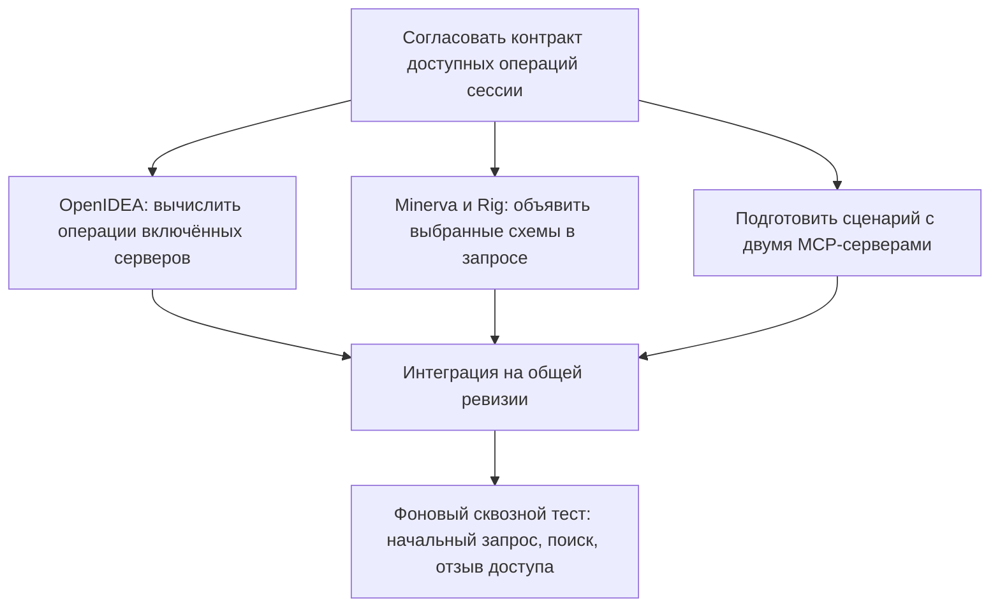

# Режим оркестратора Minerva

Этапы разработки и приёмки описаны в [плане реализации экспериментального режима](minerva-orchestrator-implementation-plan.md).

Проект режима, 27 ноября 2026 года. Пользователь включает его для агента, которому можно поручить реализацию целиком. На короткой задаче план может состоять из одного узла. На составной задаче Minerva строит граф результатов, выдаёт готовые поручения воркерам и отвечает за проверку собранного изменения.

## Как выбрать форму графа

Для каждого пункта плана оркестратор отвечает на четыре вопроса. Какой результат останется после выполнения? Кто его потребляет? Какие файлы, контракты и внешние ресурсы понадобятся? По какой проверке следующий узел сможет принять результат?

Ребро означает, что потребителю нужен конкретный результат предшественника. Например, тесту нужен патч на определённой ревизии, а двум реализациям — согласованный формат идентификатора. Git-ветка и worktree определяют, где лежат изменения. Последовательные узлы могут продолжать в одном checkout или получать версию предыдущего результата. Для читающего воркера достаточно снимка подходящей ревизии. Фоновая команда возвращает статус и артефакт проверки, поэтому ради запуска тестов отдельный модельный агент обычно излишен.

| Что обнаружила Minerva                                                           | Как построить выполнение                                                                                                                             |
| -------------------------------------------------------------------------------- | ---------------------------------------------------------------------------------------------------------------------------------------------------- |
| Два задания дают самостоятельные проверяемые результаты                          | Запустить параллельно при наличии исполнителей и свободных ресурсов. Для параллельной записи выделить изолированные рабочие копии.                   |
| Второму нужно решение первого                                                    | Провести ребро и передать результат. Промежуточный результат без самостоятельного смысла можно оставить внутри одного поручения.                     |
| Обоим нужен один новый интерфейс                                                 | Выделить общий контракт в предыдущий узел с одним владельцем. Запустить потребителей параллельно после его приёмки.                                  |
| После выделения контракта оба по-прежнему меняют одну функцию с одной семантикой | Назначить одного владельца изменения либо задать порядок. Анализ и написание независимых проверок могут идти параллельно.                            |
| Независимые патчи вместе образуют пользовательскую фичу                          | Свести их в узле интеграции и проверить поведение на объединённой ревизии. Для результатов исследований в точке схождения достаточно сверить выводы. |

Совпадение путей — повод изучить пересечение. Две функции в одном файле могут быть независимы. Разные файлы могут зависеть от общей схемы, последовательности миграций, формата сообщений или поведения API. Даже в разных worktree команды могут делить базу тестов, порт или каталог сборки. Оркестратор учитывает эти ограничения отдельно от зависимостей результатов: общий ресурс можно выдать по очереди, сохранив независимость задач.

## Пример на загрузке MCP-схем по запросу

Воркеры B и C получают одинаковую версию контракта. C может разрабатывать фильтр на тестовых данных. Воркер T готовит сценарий на отдельной территории. Проверка E запускается на ревизии, где присутствуют все три результата. Она должна увидеть фактические схемы в обоих исходящих запросах и отказ при вызове операции отключённого сервера. Зелёные локальные тесты B и C сами по себе этого не устанавливают.

## Кто принимает решения

**Модель** предлагает декомпозицию, границы изменений, альтернативы при пересечении и критерии приёмки. **Рантайм** хранит версию плана, проверяет ссылки и отсутствие циклов, выдаёт готовые узлы в пределах бюджета, управляет правом записи и сохраняет результаты попыток. При штатном завершении теста или освобождении слота рантайм может продолжить по графу самостоятельно. Оркестратор получает ход, когда нужно новое решение.

У узла есть стабильный ID, входные результаты с версиями, ожидаемый выход и правило приёмки. Патч привязан к базовой ревизии, отчёт теста — к фактически проверенной ревизии. Перед стартом писателя проверяется владение checkout, после завершения — фактический diff. Если воркер обнаружил необходимость правки вне своей зоны, он сообщает причину оркестратору. Тот может передать файл одному владельцу или перестроить оставшуюся часть плана. Изменившийся вход требует повторной проверки только затронутых потребителей. Таймаут с неизвестным исходом требует сверки состояния прежней попытки перед запуском нового писателя.

Каждый новый граф ожидает действия «Запустить». При наличии локальных правок пользователь выбирает сохранённые изменения для исходного снимка. В ходе исполнения Minerva может перестраивать граф внутри согласованной области записи. Расширение этой области требует отдельного подтверждения.

**Узел интеграции** получает принятые патчи и их базовые ревизии, собирает кандидата в отдельном рабочем дереве и запускает заданные проверки. Чистое слияние и зелёные тесты может обработать код. Конфликт с несколькими осмысленными разрешениями или расхождение контрактов возвращается оркестратору вместе с конкретными строками и диагностикой. Выход узла — проверенная ревизия в интеграционном worktree. Пользователь открывает итоговый diff и выбирает «Применить» для переноса в свою рабочую копию.

## Вкладка «Граф задачи» в Workspace

Из чата оркестратора открывается вкладка конкретного плана. На канвасе слева направо идут зависимости результатов. Независимые задачи располагаются друг над другом. У узла видны название, состояние и при ожидании короткая причина, например «ждёт контракт API» или «ждёт свободный checkout». Выбор узла открывает его входы, ожидаемый результат, исполнителя, номер попытки и доступные доказательства: diff, вывод команды, результат теста или замечание ревьювера.

**Источник состояния — планировщик.** Вкладка загружает снимок графа для конкретных задачи и плана и получает последующие изменения. Рантайм связывает запуск воркера, фоновую команду и вердикт проверки с узлом, попыткой и ревизией. Завершение процесса обновляет попытку. Узел получает состояние «Принято» после выполнения его правила приёмки. Повторное открытие и восстановление связи начинают с авторитетного состояния. Поздний результат старой попытки не меняет состояние новой. Обновление статуса сохраняет положение узлов, масштаб и выделение; изменение топологии связано с новой версией плана.

**Пример с падающим тестом.** У первого узла критерий — воспроизвести конкретный дефект на исходной ревизии. Ожидаемое падение помечает этот узел как «Дефект воспроизведён». Узел реализации получает эталонный тест для самостоятельных прогонов, а независимая проверка выполняет его из зафиксированного источника на сданном патче. При успехе планировщик запускает узел ревью, если он предусмотрен планом. При замечаниях интерфейс показывает причину и следующую попытку того же задания. После объединения зависимых патчей интеграционная проверка показывает результат для собранной ревизии.

**Основа в OpenIDEA.** Workspace уже поддерживает вкладки рядом с чатом и разворачивание на всю ширину. Связь вкладки с конкретным планом потребуется задать явно: одного workspace ID недостаточно для двух чатов в одном проекте. Для автоматической раскладки уже используется ELK. Состояния попыток и фоновых команд доступны в их действующих контрактах. Агрегированное состояние узла с его правилами приёмки — часть будущего DAG-планировщика. [Workspace](minerva-workspace.md) · [Раскладка диаграмм](../src/features/database/diagramLayout.ts) · [Состояния субагентов](../vendor/minerva/crates/plugin-sdk/src/delegation/types.rs) · [Состояния фоновых задач](../vendor/minerva/plugins/mh-workspace-tools/src/jobs/mod.rs)

## Кто уже реализовал похожий режим

Проверка публичных первоисточников от 27 ноября 2026 года. У трёх проектов есть реализация именно для coding-агентов. Их подходы отвечают на разные вопросы нашего планировщика.

| Проект                                                     | Что подтверждается источниками                                                                                                                                                                                                                                                                                                                                                                                                                                                                                                                                                                                                                                                                                                                                                                                    | Применение в Minerva                                                                                                                                                                                                             |
| ---------------------------------------------------------- | ----------------------------------------------------------------------------------------------------------------------------------------------------------------------------------------------------------------------------------------------------------------------------------------------------------------------------------------------------------------------------------------------------------------------------------------------------------------------------------------------------------------------------------------------------------------------------------------------------------------------------------------------------------------------------------------------------------------------------------------------------------------------------------------------------------------- | -------------------------------------------------------------------------------------------------------------------------------------------------------------------------------------------------------------------------------- |
| **aiatsuk/orchestrate** для Claude Code и Codex, `680f96d` | Агент описывает задачи, зависимости, пути и проверки в `plan.json`. Валидатор отвергает циклы и параллельные задания с пересечением путей, в том числе «каталог и файл внутри». Каждая задача получает свой worktree. Протокол интеграции предусматривает применение принятых патчей по зависимостям, общий прогон проверок и ревью итогового diff. На этой ревизии GitHub Actions успешно выполнил `make test`. [Протокол планирования и интеграции](https://github.com/aiatsuk/orchestrate/blob/680f96d7cf5a442ae502236d6a776c21145ce700/skill/SKILL.md) · [Тесты пересечений](https://github.com/aiatsuk/orchestrate/blob/680f96d7cf5a442ae502236d6a776c21145ce700/tests/test_plan.py#L359) · [Прогон CI](https://github.com/aiatsuk/orchestrate/actions/runs/42800201279/job/129775439865)                    | Модель предлагает план и исправляет его после диагностики. Рантайм проверяет граф до выдачи прав на запись. Проверка путей хорошо ловит видимое пересечение, а совместимость разных реализаций API проверяется на общей ревизии. |
| **Overstory**, `ff38f3f`                                   | Руководитель распределяет файлы между исполнителями. Команда `ov merge --dry-run` использует `git merge-tree`. Если прогноз требует модель, инструкция руководителю предусматривает отдельную задачу с ролью `merger`. Есть тест сохранности текущей ветки и рабочего дерева при прогнозировании. Репозиторий архивирован. [Правило создания задачи слияния](https://github.com/jayminwest/overstory/blob/ff38f3f76f084abcc34f519bcaa69580f6e53cf1/agents/lead.md#L353-L365) · [Реализация прогноза](https://github.com/jayminwest/overstory/blob/ff38f3f76f084abcc34f519bcaa69580f6e53cf1/src/merge/predict.ts) · [Тесты](https://github.com/jayminwest/overstory/blob/ff38f3f76f084abcc34f519bcaa69580f6e53cf1/src/merge/predict.test.ts) · [Статус проекта](https://github.com/jayminwest/overstory#overstory) | Узел интеграции получает результаты ветвей. Вызывать модель для разрешения конфликта можно условно. Чистое текстовое слияние всё равно проходит общую проверку.                                                                  |
| **Gas Town**, `94cc822`                                    | Компонент Refinery собирает несколько изменений, прогоняет проверки на общей вершине, при устойчивом падении разбивает группу и проверяет оставшийся набор перед публикацией. В тестах есть конфликт при сборке и поиск изменения, ломающего пакет. [Код очереди интеграции](https://github.com/gastownhall/gastown/blob/94cc82289d2ead275a62e1db4ef1d4ada4a1f98e/internal/refinery/batch.go#L202-L299) · [Тесты очереди](https://github.com/gastownhall/gastown/blob/94cc82289d2ead275a62e1db4ef1d4ada4a1f98e/internal/refinery/batch_test.go#L450-L555)                                                                                                                                                                                                                                                         | При ошибке на стыке сохранить упавшую комбинацию ревизий. Для большого набора патчей сузить воспроизводящую комбинацию и дать исполнителю конкретный тест. Две ветки могут быть по отдельности корректными.                      |

**DeepSeek Harness и Claude Code.** В проверенной версии DeepSeek Harness у элемента todo есть текст и статус, параллельные пункты допускаются, список заменяется целиком. Отдельные подсистемы предоставляют субагентов и экспериментальные worktree. В проверенных контрактах todo, plan и worktree автоматическая связь «изменения узлов → граф зависимостей → проверенное слияние» не обнаружена. Claude Code Agent Teams документирует общий список задач и автоматическую разблокировку зависимых задач после завершения предшественника. [DSH todo](https://github.com/deepseek-ai/deepseek-harness/blob/4b399c39a6d1479cd84ca591b4d7c88e24d38a96/docs/subsystems/todo.md) · [DSH worktrees](https://github.com/deepseek-ai/deepseek-harness/blob/4b399c39a6d1479cd84ca591b4d7c88e24d38a96/docs/subsystems/worktrees.md) · [Claude Code Agent Teams](https://code.claude.com/docs/en/agent-teams)

Эти материалы подтверждают существование механизмов. В нашем исследовании живой многоагентный прогон этих проектов и сравнение затрат на одинаковых задачах не проводились.

## Что можно переиспользовать

- Делегирование Minerva уже различает задание, попытку и исполнителя. Проект делегирования предусматривает планировщик DAG как следующий этап и отдельно описывает приёмку результата зависимости. [Контракт делегирования](minerva-delegation-design.md)
- У обычных задач OpenIDEA есть создание Git worktree от выбранной базы. Для пишущего субагента Minerva реализована передача права записи в checkout. Параллельным пишущим узлам потребуется связать эти механизмы и закрепить свой checkout за каждой попыткой. [Создание worktree](../crates/ide-agent/src/worktree.rs) · [Передача права записи](../crates/ide-minerva/src/writable_delegation.rs)
- У фоновой команды уже есть идентификатор и чтение результата. Планировщику потребуется связать команду и её завершение с узлом, попыткой и ревизией. [Фоновые задачи](minerva-background-jobs.md)

**Первая сквозная проверка режима** — граф с одним общим контрактом, двумя параллельными потребителями и одной фоновой проверкой интеграции. В первом прогоне обе ветки совместимы. Во втором каждая проходит свои тесты, но общий тест ловит ошибку на стыке: оркестратор должен вернуть на доработку затронутый узел и повторить интеграцию. Сравнить с последовательным агентом по принятому результату, времени до него и суммарным токенам координатора и всех воркеров. Десять субагентов и три фоновые задачи годятся для дальнейшей проверки нагрузки. Число исполнителей на реальной задаче определяется шириной готовой части графа, ресурсами и бюджетом.
